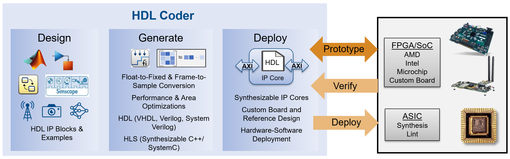

# HDL Coder Design Patterns and Examples
HDL Coder™ Examples

This collection provides HDL-ready design patterns and examples for HDL Coder.
Use them to learn how to model algorithms in MATLAB®, Simulink®, and Simscape™
for hardware implementation, and how to generate synthesizable HDL code for
FPGAs, SoCs, and ASICs.

Modeling Languages: MATLAB, Simulink, Stateflow®, Simscape, Deep Learning

Targets: AMD/Xilinx, Intel/Altera, Microchip/Microsemi, or ASIC



## Table of Contents

- [Overview](#overview)
- [What Is Included](#what-is-included)
- [Prerequisites](#prerequisites)
- [Getting Started](#getting-started)
- [Learn More](#learn-more)
- [License](#license)

---

## Overview

[HDL Coder](https://www.mathworks.com/products/hdl-coder.html) generates
portable, synthesizable VHDL, Verilog, and SystemVerilog code from MATLAB
functions, Simulink models, Stateflow charts, and Simscape models. Use it to:

- Target FPGAs, SoCs, and ASICs, including IP core generation.
- Work in fixed-point, floating-point, or a mix of both.
- Optimize for speed and area with resource sharing, pipelining, and delay
  balancing.
- Get pre-synthesis resource estimates and highlight the critical path.
- Prototype on AMD/Xilinx, Intel/Altera, and Microchip boards with the HDL
  Workflow Advisor.
- Generate High-Level Synthesis (HLS) code from MATLAB.

---

## What Is Included

```
HDL Coder Design Patterns and Examples
├── matlabhdl/          MATLAB-to-HDL design patterns
├── simulinkhdl/        Simulink-to-HDL example models
├── rcphil/             Simscape-to-HDL examples
├── hdl_demo_setup.p    utility to find and open HDL Coder examples
├── assets/             images used in this README
├── README.md           this file
└── LICENSE             license terms
```

The design patterns and examples are organized by modeling language:

| Folder | Contents |
|--------|----------|
| `matlabhdl/` | MATLAB-to-HDL design patterns grouped by topic: `basic`, `comm`, `controls`, `crypto`, `debug`, `dsp`, `dspaudio`, `fft`, `finance`, `framebased`, `hdlsysobj`, `hwsw`, `hyperbolic`, `image`, `lang`, `math`, `ml2sl`, `mlfloat2fixed`, `mlhdloptims`, `mlhdlworkflow`, `mlhlsvitis`, `mlnfp`, `mlram`, `mlsysobj`, `radar`, `random`, `wordtwiddle`. |
| `simulinkhdl/` | Simulink-to-HDL example models, including MATLAB Function block patterns, FIR filters, FFTs, counters, state machines, CORDIC, a Viterbi decoder, frame-based image and audio processing (`framebased/`), and rounding (`rounding/`). |
| `rcphil/` | Simscape-to-HDL examples of power converters, rectifiers, inverters, transformers, and motor drives for FPGA-based real-time simulation and hardware-in-the-loop (HIL) testing. |
| `hdl_demo_setup` | A utility that finds and opens HDL Coder examples by keyword. |

Most MATLAB design patterns follow this naming convention:

- `<design>.m`: the design to convert to HDL.
- `<design>_tb.m`: a testbench that simulates the design in MATLAB.
- `<design>_runme*.m`: a script that generates HDL (`_hdl`) or HLS (`_hls`)
  code from the design.

---

## Prerequisites

Required for all examples:

- [MATLAB](https://www.mathworks.com/products/matlab.html) R2026a or later
- [Simulink](https://www.mathworks.com/products/simulink.html)
- [HDL Coder](https://www.mathworks.com/products/hdl-coder.html)
- [Fixed-Point Designer™](https://www.mathworks.com/products/fixed-point-designer.html)

Additional products by folder:

- `rcphil/`: [Simscape](https://www.mathworks.com/products/simscape.html) and
  [Simscape Electrical™](https://www.mathworks.com/products/simscape-electrical.html).
- `matlabhdl/` and `simulinkhdl/`: some examples also use DSP System Toolbox™,
  Communications Toolbox™, or Image Processing Toolbox™.

Synthesis and IP core generation workflows also require a third-party
synthesis tool, such as AMD Vivado or Intel Quartus.

---

## Getting Started

1. Download the package and extract it to a folder you can write to.
2. In MATLAB, go to that folder and add it, with all its subfolders, to the
   MATLAB path:
   ```matlab
   cd("<extracted folder>")
   addpath(genpath(pwd))
   ```
   The folders stay on the path until you restart MATLAB. To keep them on
   the path for future sessions, also run `savepath`.
3. Run an example from any folder:
   - **MATLAB design:** simulate the design with its testbench, and then
     generate HDL code.
     ```matlab
     mlhdlc_sfir1_tb          % simulate the design in MATLAB
     mlhdlc_sfir1_runme_hdl   % generate HDL code
     ```
   - **Simulink model:** open and simulate the model.
     ```matlab
     open_system("sfir_fixed")
     sim("sfir_fixed")
     ```
   - **Simscape model:** open and simulate a power converter model.
     ```matlab
     open_system("sschdlexBoostConverterModel")
     sim("sschdlexBoostConverterModel")
     ```

   Code generation writes output files to the current folder, so run the
   `_runme` scripts from a writable working folder.

### Find Examples with `hdl_demo_setup`

Use `hdl_demo_setup` to find and open HDL Coder examples by keyword:

```matlab
hdl_demo_setup            % list all available examples
hdl_demo_setup("fog")     % open the example that matches "fog"
```

If more than one example matches the keyword, `hdl_demo_setup` prompts you to
choose one.

---

## Learn More

### Related Products

These products extend HDL Coder for verification and for domain-specific
hardware designs:

| Product | Use it to |
|---------|-----------|
| [HDL Verifier™](https://www.mathworks.com/products/hdl-verifier.html) | Test FPGA and ASIC designs with cosimulation and generated testbenches. |
| [Vision HDL Toolbox™](https://www.mathworks.com/products/vision-hdl.html) | Design pixel-streaming video and vision algorithms for FPGAs and ASICs. |
| [DSP HDL Toolbox™](https://www.mathworks.com/products/dsp-hdl.html) | Build signal processing designs with hardware-ready blocks and algorithms. |
| [Wireless HDL Toolbox™](https://www.mathworks.com/products/wireless-hdl.html) | Design 5G, LTE, WLAN, and custom OFDM systems for FPGAs, ASICs, and SoCs. |
| [Deep Learning HDL Toolbox™](https://www.mathworks.com/products/deep-learning-hdl.html) | Run deep learning networks on FPGAs and SoCs. |

### Tutorials

- [HDL Coder Self-Guided Tutorial (Simulink to HDL)](https://github.com/mathworks/HDL-Coder-Self-Guided-Tutorial):
  Learn how to deploy an algorithm to an FPGA using MATLAB and Simulink.
- [HDL Coder Self-Guided Tutorial (MATLAB to HDL)](https://www.mathworks.com/matlabcentral/fileexchange/50098-hdlcoder-design-patterns-and-examples):
  Download these design patterns and examples from MATLAB Central File Exchange.

---

## License

See [License](LICENSE).

---

MATLAB and Simulink are registered trademarks of The MathWorks, Inc. See
[mathworks.com/trademarks](https://www.mathworks.com/trademarks) for a list of
additional trademarks. Other product or brand names may be trademarks or
registered trademarks of their respective holders.

© 2026 The MathWorks, Inc.
